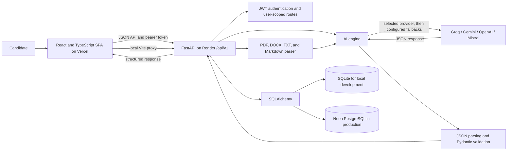

# TalentVerse

**Turn career evidence into a clearer next step.**

TalentVerse is a full-stack career intelligence application for exploring how a candidate's skills, experience, and goals relate to career development. It combines resume analysis, an editable candidate profile, learning roadmaps, job matching, interview practice, and portfolio project recommendations in one workspace.

[](https://www.python.org/)
[](https://fastapi.tiangolo.com/)
[](https://react.dev/)
[](https://www.typescriptlang.org/)
[](https://vite.dev/)
[](#deployment)

> **Live demo:** [Open TalentVerse](https://talentverse-sandy.vercel.app)
>
> **Project status:** Deployed. The frontend is hosted on Vercel, the API on Render, and production data is stored in Neon PostgreSQL.

TalentVerse is designed to connect resume evidence to practical follow-up work. AI-generated assessments are estimates, should be reviewed by the candidate, and do not guarantee recruiter or hiring outcomes.

## Table of contents

- [Project overview](#project-overview)
- [Features](#features)
- [Screenshots](#screenshots)
- [Architecture](#architecture)
- [Technology stack](#technology-stack)
- [Repository structure](#repository-structure)
- [Installation and local setup](#installation-and-local-setup)
- [Environment variables](#environment-variables)
- [Deployment](#deployment)
- [API reference](#api-reference)
- [Database and persistence](#database-and-persistence)
- [AI behavior and limitations](#ai-behavior-and-limitations)
- [Testing](#testing)
- [Security and privacy](#security-and-privacy)
- [Known limitations](#known-limitations)
- [Development roadmap](#development-roadmap)
- [Contributing](#contributing)
- [License](#license)

## Project overview

Job seekers often have useful experience and skills spread across resumes, projects, and interview preparation. A resume-only score rarely explains what to do next or how the candidate's evidence relates to a particular role.

TalentVerse brings several career-development workflows together:

- Extract and review information from a resume.
- Maintain an editable, persistent candidate profile.
- Create a learning roadmap around a stated career goal.
- Compare a profile with a supplied job description.
- Practice role-specific interview questions and review answer feedback.
- Generate portfolio project briefs based on interests and skills.

The application uses AI to produce structured suggestions from the information supplied to it. The candidate profile and saved reports provide continuity between these workflows; generated content remains advisory and should be checked for accuracy.

## Features

### AI Resume Analyzer

- Upload PDF, DOCX, TXT, or Markdown (`.md`) files, or paste resume text.
- Extract document text and request structured profile and resume-analysis fields.
- Display skills, experience, education, certifications, projects, recommendations, and missing information when returned.
- Provide an AI-generated ATS-readiness estimate, explanation, section-completeness details, and keyword observations when a complete analysis is available.
- Persist resume records and analysis for the authenticated user.
- Reject incomplete resume-AI responses rather than presenting schema defaults as a completed analysis. If configured providers cannot produce a complete result, the API reports an error instead of inventing a score.
- Export the displayed analysis as JSON.

Resume parsing supports text-based PDFs; scanned/image-only PDFs need OCR, which is not included.

### Candidate Profile

- View and edit candidate identity, contact, career target, experience level, summary, skills, experience, education, certifications, and projects.
- Persist detailed resume-analysis data separately from the ordinary editable profile fields.
- Reuse profile information in roadmap, job-match, project-recommendation, and interview workflows.
- Preserve saved AI analysis when ordinary profile fields are updated.

### AI Career Roadmap

- Generate a week-by-week roadmap from a career goal, experience level, known skills, and a duration of 2–52 weeks.
- View skill gaps, learning tasks, deliverables, success criteria, and recommended resources when returned by the AI provider.
- Mark milestones complete; completion and roadmap progress are saved.
- Export the roadmap as JSON.

### AI Job Matcher

- Compare a candidate profile with a supplied job description.
- Review a match estimate, matching skills, missing or unverified skills, evidence, and improvement actions.
- Use the saved profile or submit a custom profile.

The match score is an AI estimate, not a hiring decision.

### AI Interview Coach

- Generate technical or behavioral questions for a target role and experience level.
- Submit an answer for structured feedback, including a score, strengths, improvement areas, missing concepts, a suggested answer, practice tasks, and a next-session focus.
- Save evaluated answers to interview history and the reports archive.

### AI Project Recommendations

- Request portfolio-project briefs using interests, skills, domain, and difficulty.
- Review problem statements, target users, features, suggested technology, milestones, evaluation metrics, and a portfolio description when provided.
- Browse recently saved project briefs.

### AI provider selection

- Select a configured provider in the application; the provider's model ID is configured on the backend.
- The selected provider is tried first when configured. Other configured providers are tried according to the server's provider order if a request fails or its response is invalid.
- The Settings page shows configured provider names and model IDs. A “key loaded” indicator means a key value is configured; it is **not** a live provider health check.

### Dashboard, reports, settings, and accounts

- The dashboard summarizes profile readiness, listed skills, roadmap progress, recent job-fit results, recent reports, and suggested next actions.
- Saved Reports supports type filtering, search, detail viewing, JSON export, and deletion.
- Settings provides light/dark appearance, provider-configuration status, and local sign-out.
- Users can register and sign in with email and password, or start a separate temporary demo workspace.

## Screenshots

The repository does not currently include product screenshots. The following are **placeholders only**, not image files:

| Screen | Placeholder path |
| --- | --- |
| Landing page | `docs/screenshots/landing-page.png` |
| Dashboard | `docs/screenshots/dashboard.png` |
| Resume Analyzer | `docs/screenshots/resume-analyzer.png` |
| ATS analysis results | `docs/screenshots/ats-analysis.png` |
| Candidate Profile | `docs/screenshots/candidate-profile.png` |
| Career Roadmap | `docs/screenshots/career-roadmap.png` |
| Job Matcher | `docs/screenshots/job-matcher.png` |
| Interview Coach | `docs/screenshots/interview-coach.png` |
| Project Recommendations | `docs/screenshots/project-recommendations.png` |
| Settings | `docs/screenshots/settings.png` |

To add screenshots later, create `docs/screenshots/`, capture the running application without real candidate data or secrets, add the image files, and replace the placeholder paths with Markdown image links.

## Architecture



### Component responsibilities

- **React frontend:** Provides the public landing and authentication pages, protected application workspace, feature forms, provider selection, and result views. It is hosted on Vercel in production.
- **FastAPI backend:** Exposes the versioned API, validates request and response data, requires JWT authentication for user-owned routes, and coordinates feature workflows. It is hosted on Render in production.
- **Resume parser:** Extracts text from supported file formats before AI analysis. It does not include OCR.
- **AI engine:** Calls configured providers, parses JSON, validates responses, applies resume-specific completeness checks, and falls back to other configured providers when possible.
- **SQLAlchemy and database:** Persist accounts, profiles, resume records, roadmaps, job matches, project briefs, interview evaluations, and saved reports. Local development defaults to SQLite; production uses Neon PostgreSQL.
- **Provider services:** Receive the prompt and relevant candidate data required for an AI operation. Provider availability, model access, and quotas depend on the provider account.

In local development, Vite serves the frontend on port `5173` and proxies `/api` requests to FastAPI on port `8000`. The deployed frontend is served by Vercel and calls the Render API directly. FastAPI can also serve `frontend/dist` when present, for local builds or other single-service setups.

## Technology stack

| Area | Technologies used |
| --- | --- |
| Frontend | React 19, TypeScript, Vite, Tailwind CSS, React Router, Lucide React |
| Frontend state | React Context for authentication, theme, and toast notifications; browser `localStorage` for token, theme, and preferred provider |
| Backend | Python 3.10+ syntax, FastAPI, Uvicorn, Pydantic 2 |
| Persistence | SQLAlchemy ORM; SQLite locally and Neon PostgreSQL in production |
| Authentication | JWT bearer tokens via PyJWT; salted PBKDF2-SHA256 password hashing |
| AI providers | Groq, Google Gemini, OpenAI, and Mistral SDKs |
| Resume parsing | PyMuPDF for PDF, `python-docx` for DOCX, Python standard library for TXT/Markdown |
| Configuration | `python-dotenv`; root-level `.env` and process environment variables |
| Backend tests | pytest |
| Frontend checks | oxlint and TypeScript (`tsc`) |

Dependency ranges are declared in `requirements.txt` and `frontend/package.json`; they are not all pinned to exact versions.

## Repository structure

```text
.
├── backend/
│   ├── ai_engine.py             # Provider calls, prompts, fallback, and validation
│   ├── auth_utils.py            # JWT and password utilities
│   ├── config.py                # Environment configuration and defaults
│   ├── database.py              # SQLAlchemy models, initialization, additive migration
│   ├── file_parser.py           # Resume text extraction
│   ├── main.py                  # FastAPI app, middleware, routers, health, static frontend
│   ├── profile_context.py       # Bounded candidate context for AI features
│   ├── schemas.py               # Pydantic request and response schemas
│   ├── routes/
│   │   ├── analytics.py
│   │   ├── auth.py
│   │   ├── interviews.py
│   │   ├── jobs.py
│   │   ├── profiles.py
│   │   ├── projects.py
│   │   ├── reports.py
│   │   ├── resumes.py
│   │   ├── roadmaps.py
│   │   └── system.py
│   └── tests/
│       ├── test_api.py
│       └── test_database_migrations.py
├── frontend/
│   ├── public/
│   ├── src/
│   │   ├── components/
│   │   │   ├── layout/
│   │   │   └── ui/
│   │   ├── context/
│   │   ├── hooks/
│   │   ├── pages/
│   │   ├── services/api.ts
│   │   └── types/
│   ├── package.json
│   └── vite.config.ts
├── .devcontainer/
├── .env.example
├── requirements.txt
├── requirements-dev.txt
├── start_backend.ps1
└── start_frontend.ps1
```

The local `talentverse.db` and `talentverse_profiles.json` data files are ignored by Git and are intentionally not listed as source files. The legacy JSON profile file is still read on demand for a matching account when that account has no SQLAlchemy profile; back it up and do not commit it.

## Installation and local setup

### Prerequisites

- Python 3.10 or later. The included dev-container uses Python 3.11.
- Node.js `^20.19.0` or `>=22.12.0` and npm, as required by the installed Vite toolchain.
- Git.
- At least one supported AI provider API key for AI-generated features. The app can start without a provider key, but AI requests will return an unavailable error.

### Windows PowerShell

Clone the repository and create the backend environment from the repository root:

```powershell
git clone https://github.com/Amar377/TalentVerse-Skills-Career-Intelligence.git
Set-Location TalentVerse-Skills-Career-Intelligence

py -3.11 -m venv .venv
.\.venv\Scripts\python.exe -m pip install --upgrade pip
.\.venv\Scripts\python.exe -m pip install -r requirements.txt

if (-not (Test-Path .env)) {
    Copy-Item .env.example .env
}
```

Edit the root `.env` file and configure a strong local JWT secret and at least one provider key. See [Environment variables](#environment-variables). Do not overwrite an existing `.env`.

Install frontend dependencies:

```powershell
Set-Location frontend
npm ci
Set-Location ..
```

Run the backend and frontend in **separate PowerShell terminals**. In the first terminal, from the repository root:

```powershell
.\start_backend.ps1
```

In the second terminal:

```powershell
.\start_frontend.ps1
```

Open [http://localhost:5173](http://localhost:5173). The backend health endpoint is [http://127.0.0.1:8000/api/health](http://127.0.0.1:8000/api/health), and interactive API documentation is at [http://127.0.0.1:8000/docs](http://127.0.0.1:8000/docs).

The frontend uses the relative API path `/api/v1`; Vite proxies it to the local backend. No frontend `.env` file or API-base URL variable is required for the supplied local setup.

### Linux and macOS

From the repository root:

```bash
git clone https://github.com/Amar377/TalentVerse-Skills-Career-Intelligence.git
cd TalentVerse-Skills-Career-Intelligence

python3 -m venv .venv
source .venv/bin/activate
python -m pip install --upgrade pip
python -m pip install -r requirements.txt

if [ ! -f .env ]; then cp .env.example .env; fi
```

Edit `.env`, then install frontend dependencies:

```bash
cd frontend
npm ci
```

Start the backend from the repository root in one terminal:

```bash
source .venv/bin/activate
python -m uvicorn backend.main:app --host 127.0.0.1 --port 8000 --reload
```

Start Vite from `frontend/` in a second terminal:

```bash
npm run dev
```

Open [http://localhost:5173](http://localhost:5173).

### Build and serve the frontend through FastAPI

After installing dependencies, build the frontend:

```powershell
Set-Location frontend
npm ci
npm run build
Set-Location ..
```

Then run FastAPI from the repository root without `--reload`:

```powershell
.\.venv\Scripts\python.exe -m uvicorn backend.main:app --host 127.0.0.1 --port 8000
```

FastAPI serves the compiled frontend from `frontend/dist` when it is present. This is an optional local/single-service setup; the production frontend is hosted separately on Vercel.

## Environment variables

Backend configuration loads `.env` from the repository root and does not override variables already set in the process environment. Provider keys are used by the backend only. The table describes variable names verified in `backend/config.py`, `backend/ai_engine.py`, and `.env.example`; blank key examples are placeholders, not real credentials.

| Variable | Purpose | Required? | Example or default |
| --- | --- | ---: | --- |
| `TALENTVERSE_ENV` | Selects development or production checks. | Optional | `development`; use `production` when deployed |
| `TALENTVERSE_SECRET_KEY` | Signs JWT access tokens using HS256. Production requires at least 32 characters. | Required for production; optional locally | Generate a private random value, for example with `python -c "import secrets; print(secrets.token_urlsafe(32))"` |
| `DATABASE_URL` | SQLAlchemy connection URL. Defaults to SQLite locally; production requires PostgreSQL. | Optional locally; required in production | Local default: `sqlite:///./talentverse.db`; production: use the Neon PostgreSQL connection URL in the hosting environment |
| `CORS_ORIGINS` | Comma-separated allowed browser origins. Production rejects `*`. | Optional locally; required in production | Local default: `http://localhost:5173,http://127.0.0.1:5173`; production: `https://talentverse-sandy.vercel.app` |
| `AI_PROVIDER_ORDER` | Server-side provider priority and fallback order. | Optional; at least one configured provider is needed for AI requests | Unset runtime default: `groq,gemini,openai,mistral`. The checked-in `.env.example` uses `gemini,groq,openai,mistral`. |
| `GOOGLE_API_KEY` | Google Gemini API credential. | Optional; required to use Gemini | `<your-google-api-key>` |
| `GEMINI_MODEL` | Gemini model ID. | Optional | `gemini-3.8-flash` |
| `GROQ_API_KEY` | Groq API credential. | Optional; required to use Groq | `<your-groq-api-key>` |
| `GROQ_MODEL` | Groq model ID. | Optional | `llama-3.3-70b-versatile` |
| `OPENAI_API_KEY` | OpenAI API credential. | Optional; required to use OpenAI | `<your-openai-api-key>` |
| `OPENAI_MODEL` | OpenAI model ID. | Optional | `gpt-4o-mini` |
| `MISTRAL_API_KEY` | Mistral API credential. | Optional; required to use Mistral | `<your-mistral-api-key>` |
| `MISTRAL_MODEL` | Mistral model ID. | Optional | `mistral-small-latest` |
| `TALENTVERSE_SESSION_DAILY_LIMIT` | In-memory AI request limit per session and day. | Optional | `20` |
| `TALENTVERSE_GLOBAL_DAILY_LIMIT` | In-memory AI request limit across the process and day. | Optional | `200` |
| `TALENTVERSE_DUPLICATE_COOLDOWN_SECONDS` | Duplicate-request cooldown. The configured minimum is 3 seconds. | Optional | `10` |
| `VITE_API_BASE_URL` | Frontend build-time API origin. The frontend appends `/api/v1`; set this in Vercel for production. | Required for the deployed frontend | `https://talentverse-api-0w4g.onrender.com` |

Model IDs and availability change over time. Configure a model ID supported by the corresponding provider. Provider key configuration in Settings does not verify the key or model with a live request.

`VITE_API_BASE_URL` is read by the frontend at build time. Leave it unset for local development, where Vite proxies `/api` to the local backend. It is an API origin, not a full API path: the frontend adds `/api/v1`.

## Deployment

TalentVerse is publicly deployed:

- **Live frontend:** [https://talentverse-sandy.vercel.app](https://talentverse-sandy.vercel.app)
- **Backend API:** [https://talentverse-api-0w4g.onrender.com](https://talentverse-api-0w4g.onrender.com)
- **Backend health:** [https://talentverse-api-0w4g.onrender.com/api/health](https://talentverse-api-0w4g.onrender.com/api/health)
- **Interactive API docs:** [https://talentverse-api-0w4g.onrender.com/docs](https://talentverse-api-0w4g.onrender.com/docs)

The production frontend is hosted on Vercel, the FastAPI backend on Render, and application data in Neon PostgreSQL. Keep credentials and database connection values in the hosting providers' private environment-variable settings; never add them to this README or commit them.

### Deploy the backend to Render

The repository includes a Render Blueprint in `render.yaml`. To deploy or update the backend:

1. Connect the repository to Render and create the service from `render.yaml`. It defines a Python web service, installs `requirements.txt`, starts Uvicorn, and uses `/api/health` as its health check.
2. In Render's environment settings, provide `DATABASE_URL` with the Neon PostgreSQL connection value. Keep the value private; production startup rejects a missing or non-PostgreSQL database.
3. Set `TALENTVERSE_ENV` to `production`, configure `CORS_ORIGINS` to the exact deployed frontend origin (`https://talentverse-sandy.vercel.app`), and ensure `TALENTVERSE_SECRET_KEY` is a private strong value of at least 32 characters. The Blueprint requests a generated value for the secret.
4. Add the API key for each AI provider you want to enable. Optionally set `AI_PROVIDER_ORDER` to control provider priority.
5. Deploy and verify the service's `/api/health` endpoint. The versioned application routes are under `/api/v1`.

### Deploy the frontend to Vercel

1. Import the repository in Vercel and set the project root directory to `frontend`.
2. Use `npm run build` as the build command and `dist` as the output directory.
3. In the Vercel project environment settings, set `VITE_API_BASE_URL` to `https://talentverse-api-0w4g.onrender.com` for the Production environment. Do not append `/api/v1`; the frontend adds it.
4. Redeploy after changing environment variables, since Vite embeds them during the frontend build.
5. Confirm the deployed site loads and can reach the backend. The backend's `CORS_ORIGINS` must include the exact frontend origin.

For a separate Vercel preview domain, add that exact origin to `CORS_ORIGINS` only if preview access is intended. Production CORS configuration must not use `*`.

## API reference

The backend mounts application routes under `/api/v1`. Except for authentication creation/login, system status, and the health check, the endpoints below require an `Authorization: Bearer <token>` header. Request and response models are documented in FastAPI Swagger UI at `/docs`.

### Health and authentication

| Method | Path | Auth | Purpose and request/response |
| --- | --- | --- | --- |
| `GET` | `/api/health` | No | Basic backend health and version. |
| `POST` | `/api/v1/auth/register` | No | Register with `email`, `password`, and `full_name`; creates an initial profile and returns a token and user. |
| `POST` | `/api/v1/auth/login` | No | Authenticate with `email` and `password`; returns a token and user. |
| `POST` | `/api/v1/auth/demo` | No | Creates an isolated temporary demo workspace and returns a token and user. |
| `GET` | `/api/v1/auth/me` | Bearer | Returns the authenticated user. |

### Resume Analyzer

| Method | Path | Auth | Purpose and request/response |
| --- | --- | --- | --- |
| `POST` | `/api/v1/resumes/upload` | Bearer | Multipart upload with `file`, optional `preferred_provider`, and `replace_profile`; returns extracted text, structured profile, and provider/model metadata. |
| `POST` | `/api/v1/resumes/analyze-text` | Bearer | JSON body with `resume_text` (at least 30 readable characters), optional `preferred_provider`, and `replace_profile`; returns the same analysis shape as upload. |
| `GET` | `/api/v1/resumes/latest` | Bearer | Returns the latest saved resume analysis, or `null` when none exists. An incomplete legacy result returns a service-unavailable error instructing the user to re-upload. |

Uploads accept PDF, DOCX, TXT, and Markdown files up to 10 MiB. Scanned PDFs require OCR, which is not provided.

### Candidate Profiles

| Method | Path | Auth | Purpose and request/response |
| --- | --- | --- | --- |
| `GET` | `/api/v1/profiles/me` | Bearer | Returns the authenticated user's profile, including saved nested resume analysis. |
| `PUT` | `/api/v1/profiles/me` | Bearer | Updates fields present in the request; analysis replacement is handled separately from ordinary profile updates. |
| `GET` | `/api/v1/profiles` | Bearer | Lists profiles belonging to the authenticated user. |

### Career Roadmaps

| Method | Path | Auth | Purpose and request/response |
| --- | --- | --- | --- |
| `POST` | `/api/v1/roadmaps/generate` | Bearer | Generates and saves a roadmap from `skills`, `career_goal`, optional `experience_level`, `duration_weeks` (2–52), and `preferred_provider`. |
| `GET` | `/api/v1/roadmaps/latest` | Bearer | Returns the latest roadmap, or `null`. |
| `GET` | `/api/v1/roadmaps` | Bearer | Lists the user's roadmaps. |
| `PUT` | `/api/v1/roadmaps/{roadmap_id}/milestone` | Bearer | Updates `completed` for a milestone identified by `week`; returns the updated roadmap. |

### Job Matcher

| Method | Path | Auth | Purpose and request/response |
| --- | --- | --- | --- |
| `POST` | `/api/v1/jobs/match` | Bearer | Compares a `job_description` (at least 25 characters) with the saved profile or a supplied `profile_id`/`custom_profile`; accepts optional role, company, and provider; saves the match. |
| `GET` | `/api/v1/jobs/latest` | Bearer | Returns the latest saved job match; returns `404` when there is none. |
| `GET` | `/api/v1/jobs` | Bearer | Lists the user's job matches. |

### Interview Coach

| Method | Path | Auth | Purpose and request/response |
| --- | --- | --- | --- |
| `POST` | `/api/v1/interviews/questions` | Bearer | Generates questions from `target_role`, `interview_type`, and `level`, with optional provider selection and candidate context. |
| `POST` | `/api/v1/interviews/evaluate` | Bearer | Evaluates a submitted `question` and `user_answer` for a target role and interview type; saves the evaluation. |
| `GET` | `/api/v1/interviews/history` | Bearer | Lists the user's saved interview evaluations. |

### Project Recommendations

| Method | Path | Auth | Purpose and request/response |
| --- | --- | --- | --- |
| `POST` | `/api/v1/projects/generate` | Bearer | Generates project briefs from `interests` (at least 5 characters), optional skills, domain, difficulty, and provider; uses profile context when available. |
| `GET` | `/api/v1/projects` | Bearer | Lists up to the user's 9 most recent project briefs. |

### Reports, analytics, and system status

| Method | Path | Auth | Purpose and request/response |
| --- | --- | --- | --- |
| `GET` | `/api/v1/reports?report_type=resume` | Bearer | Lists the user's saved reports, optionally filtered by report type. |
| `POST` | `/api/v1/reports` | Bearer | Saves a report from `report_type`, `title`, optional summary/score/tags, and `data`. |
| `GET` | `/api/v1/reports/{report_id}` | Bearer | Returns one report owned by the authenticated user. |
| `DELETE` | `/api/v1/reports/{report_id}` | Bearer | Deletes one report owned by the authenticated user. |
| `GET` | `/api/v1/analytics/dashboard` | Bearer | Returns profile, roadmap, job-match, activity, and recommended-action summaries. |
| `GET` | `/api/v1/system/status` | No | Reports configured provider names, model IDs, key-variable names, and whether values are configured; it does not test provider availability. |

## Database and persistence

Local development defaults to SQLite at `sqlite:///./talentverse.db`, relative to the backend's working directory. The deployed production service uses Neon PostgreSQL through `DATABASE_URL`. SQLAlchemy models represent:

- `User`
- `CandidateProfileModel`
- `ResumeRecordModel`
- `RoadmapModel`
- `JobMatchModel`
- `ProjectBriefModel`
- `InterviewModel`
- `SavedReportModel`

The candidate profile stores ordinary editable fields and a JSON `resume_analysis` field for detailed ATS and section analysis. Resume records store extracted raw text and parsed analysis; related reports and feature records are also persisted by user.

At startup, `Base.metadata.create_all()` creates missing tables. The code also performs an additive migration that adds `candidate_profiles.resume_analysis` to an existing table when it is absent. This is a focused migration, not a general versioned migration system; there is no Alembic setup. Back up the database before upgrades and review future schema changes carefully.

The legacy `talentverse_profiles.json` file is read only when a user has no database profile and a legacy record matches that account's email. The file is Git-ignored. Preserve or securely back it up until its data is no longer needed.

## AI behavior and limitations

1. The backend builds a feature prompt from resume text, a job description, or bounded candidate context.
2. The selected provider is tried first when configured; remaining configured providers are tried in server priority order after errors or rejected output.
3. Provider output is parsed as JSON and validated against Pydantic models. The Groq adapter uses JSON Schema response mode for documented compatible models and JSON Object Mode for other models.
4. Resume analysis additionally requires the expected top-level fields, a score and explanation, section-completeness information, and analysis for populated profile sections. Incomplete results are not saved as successful resume analyses.
5. If all configured providers fail, the API returns `503 Service Unavailable`. It does not create a replacement ATS score or fabricate missing candidate facts.

The prompt instructs the model to use evidence from the supplied data and not invent dates, qualifications, outcomes, skills, or target roles. This instruction is not a guarantee of factual accuracy. Review all generated content.

The selected provider's availability, model access, quotas, latency, and data policies are external to this application. The Settings page confirms only whether a key variable is populated. Rate limits and duplicate-request controls implemented by the backend are in-memory and are not shared across multiple worker processes.

## Testing

### Backend tests

Install the development test dependency:

```powershell
.\.venv\Scripts\python.exe -m pip install -r requirements-dev.txt
```

For a local test run that avoids writing into the default application database and does not configure live providers:

```powershell
$env:DATABASE_URL = "sqlite:///./talentverse_test.db"
$env:AI_PROVIDER_ORDER = "disabled"
.\.venv\Scripts\python.exe -m pytest backend\tests -q
Remove-Item Env:DATABASE_URL -ErrorAction SilentlyContinue
Remove-Item Env:AI_PROVIDER_ORDER -ErrorAction SilentlyContinue
```

The suite includes API and authorization regression tests, resume-analysis validation tests, and an additive database migration test. Two integration tests call external AI providers only when `RUN_LIVE_AI_TESTS=1` and a provider key is configured; those requests may consume provider quota and send test prompts to that provider.

### Frontend checks

From `frontend/`:

```powershell
npm run lint
npm run build
npm test
```

The build command runs `tsc -b` before the Vite production build. `npm test` runs the Node.js test runner for the frontend API-base URL tests.

## Security and privacy

- Never commit `.env`, API keys, JWT secrets, tokens, local database files, or candidate data. `.gitignore` excludes these local files.
- Provider keys are read by the backend and are not sent to the browser. `/api/v1/system/status` exposes configuration state and key-variable names, not key values.
- Registered passwords are stored as salted PBKDF2-SHA256 hashes. Protected API routes require a JWT bearer token; tokens expire after seven days.
- A new demo login creates a separate temporary user workspace. Expired generated demo accounts and their records are cleaned periodically.
- User-owned records are queried using the authenticated user's ID.
- Uploaded file bytes are parsed by the backend; extracted resume text and analysis are stored in the user's database records. Resume text is also sent to whichever configured AI provider processes that request.
- Roadmap, project, and interview prompts use a bounded candidate context that excludes contact fields. Job matching serializes the selected candidate profile for the AI request; do not include information you do not want sent to the configured provider.
- Resume uploads are limited to 10 MiB and accepted formats are checked by extension. Scanned PDF OCR and malware scanning are not included.
- In production, set `TALENTVERSE_ENV=production`, use a private `TALENTVERSE_SECRET_KEY` of at least 32 characters, and configure explicit `CORS_ORIGINS`.
- The default development secret is not suitable for deployment. Protect local SQLite files and backups with appropriate operating-system access controls, and manage production database access through the hosting provider.
- AI diagnostics should not include API keys, raw resume text, or complete provider output. Provider SDK and account policies still govern external processing.

## Known limitations

- AI provider services may be unavailable, reject a model ID, or enforce quotas. A configured key is not proof of connectivity.
- Resume extraction is text-based; image-only/scanned PDFs need OCR.
- Resume analysis and ATS readiness are AI-generated estimates, not results from a specific commercial ATS or a hiring guarantee.
- Models may omit or misinterpret information. Resume outputs that fail completeness checks are rejected, but successful outputs still require human review.
- Request limits and duplicate suppression are process-local. A multi-worker deployment needs shared coordination and production monitoring.
- SQLite is used for local development; production uses Neon PostgreSQL. The publicly deployed frontend and backend depend on their hosting providers and configured external AI services.
- No repository `LICENSE` file, `CONTRIBUTING.md`, or screenshot collection is currently included.

## Development roadmap

These are possible future improvements, not features currently claimed as complete:

- Add OCR for scanned resumes and evaluate extraction quality against representative documents.
- Introduce versioned, reviewed database migrations for all schema changes.
- Add shared rate limiting and operational monitoring for multi-worker deployments.
- Add automated frontend component and browser-level tests.
- Expand evaluation datasets and provider-specific structured-output handling.
- Add data-retention controls and production operational monitoring.

## Contributing

Contributions are welcome. Before opening a pull request:

1. Open an issue in the [GitHub repository](https://github.com/Amar377/TalentVerse-Skills-Career-Intelligence) to discuss larger changes or report a reproducible bug.
2. Create a focused branch and keep changes scoped to one behavior or fix.
3. Add or update tests for behavior changes.
4. Run the backend suite and frontend lint/build checks described above.
5. Do not include `.env`, secrets, real resumes, database files, or personal data in commits, fixtures, logs, or screenshots.
6. Describe the change, verification performed, and any migration or configuration impact in the pull request.

There is no separate contribution guide yet; this section describes the current suggested workflow.

## License

No `LICENSE` file is currently present, so the repository does not specify a license. Do not assume the code is available under MIT or another open-source license.
